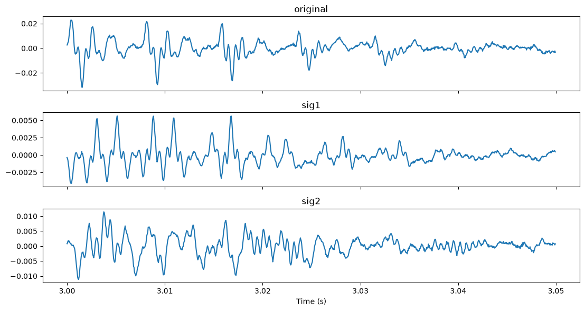
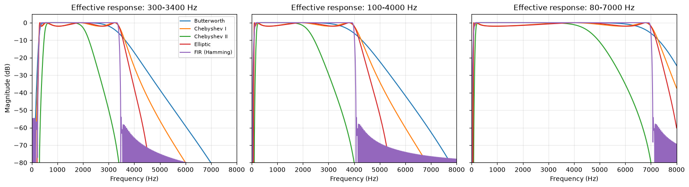

# STFT Magnitude/Phase and STOI Analysis 

Short description: experiments on the role of STFT magnitude and phase in speech, reconstruction from magnitude only, phase scrambling and recovery, and the effect of noise and band-pass filtering on STOI.
Access notebook here: 


## Additional exploration
See `miscellaneous/test.ipynb` for the parameter studies (window length, overlap, Griffin-Lim iterations, filter families and bands).

# Answers to all the questions
- # What is the difference between the original and sig1. Give reasoning and analysis.

** diff and analysis **
- The amplitude envelope of original and sig1 are same meaning every word spoken and tone are same in times . The STFT magnitude, which holds the energy at each time and frequency, was preserved.
- The waveform does not match sample by sample: correlation with the original is 0.043 and SI-SDR is -27.3 dB.
- STOI is similar yielding 0.8419 which is good
- peak amplitude is lower in sig1 (0.042 vs 0.173). rms (0.0125 vs 0.0026)

** reasoning **
- stoi is sensitive to band envelopes at about 26ms resolution, so largely cannot detect the phase damage, when taken SI-SDR or listening it we can distiguish the diff almost robotic
- # Is it possible to get real valued sig2?
- NO for arbitary PH1 , but can be done if PH1 has the right symmetry
- reason : A real time-domain signal has a conjugate-symmetric spectrum, X[N−k] = conj(X[k]). Since MG is the magnitude of a real signal, it is already even in frequency, so the condition reduces to the phase being odd. A random PH1 breaks this symmetry, so the imaginary parts of the frames do not cancel.
- # What is the difference between the original and sig2. Give reasoning and analysis
** diff and analysis
- Same as orginal vs sig1 here also the amplitude envelope matches but the waveform is bit different : correlation being quite low = -0.06849297798356647 and SI-SDR =  -23.266639530896768
```python
def si_sdr(ref, est, eps=1e-12):
    ref = ref - ref.mean()
    est = est - est.mean()
    alpha = np.dot(est, ref) / (np.dot(ref, ref) + eps)
    target = alpha * ref
    noise = est - target
    return 10 * np.log10((np.sum(target**2) + eps) / (np.sum(noise**2) + eps))
```
- stoi holds pretty well 0.86 which also implied from the audio of sig2
- audibly sig2 sounds like underwater talking
** reasoning **
- MG was kept which explains reason one
- PH1 is random, so the timing relationship between frequency components within each frame is destroyed. The phases also don't agree between overlapping frames, so the modified STFT is not a consistent one.
- stoi being is the same reason given for sig1
- # What is the difference between sig1 and sig2. Give reasoning and analysis
** diff and analysis **
- The two signals are essentially uncorrelated: correlation 0.009, SI-SDR -40.9 dB.
- sig2 is louder: RMS 0.0064 vs 0.0026 (about 7.8 dB). Re-analysing the signals retains 26.4% of the original magnitude energy for sig2 and 4.2% for sig1.
- STOI of sig2 with sig1 as the reference is 0.784. This measures envelope similarity between the two signals, not intelligibility.
** reasoning **
-  Both signals use the same magnitude MG hence stoi score good enough
- they differ in phase 
- Because the phase patterns are unrelated, the waveforms are unrelated 

- # Is there a pattern in PH1 that ensures real valued sig2? 
- so the sig2 to be real time_signal should satisify x[N-k]=conj(x[k])
- so PH1[N−k] = −PH1[k] for k = 1 … N/2 − 1 (the phase is an odd function of frequency; where MG = 0 the phase does not matter), and
- PH1[0] and PH1[N/2] (DC and Nyquist) equal 0 or π, because these two bins must be real.

** in miscilleaneos/test checked numerically **
- Arbitrary random PH1: max|imag| = 5.93e-2 against max|real| = 6.37e-2, so sig2 is complex.
- Odd PH1 with DC and Nyquist = 0: max|imag| = 1.24e-17, so sig2 is real

- # how many patterns
Per frame (N = 512), the choices are the N/2 − 1 = 255 phase values for k = 1 … 255. Each can be any real value in [0, 2π], and the other half of the spectrum then follows. DC and Nyquist each have 2 choices (0 or π). The frames are independent, so with F = 1795 frames the patterns multiply across frames.
- Counted as real numbers, there are **infinitely many** valid patterns (a continuum of dimension 255 per frame, 255·F in total).
- If the phase were quantised to L levels, the count would be 4 · L^255 per frame, and (4 · L^255)^F for the whole signal.
- # design choice for the filter and reason
- so i tested out all types of bandpass filter like fir,chebyshev I and II , eliptic and butterworth after testing heres what i found

	                            
                                   White	Babble
SNR gain at 100-4000 (Butterworth)	+4.2 dB	+0.06 dB

STOI change at 100-4000	            +0.0007	-0.0012

SNR gain at 300-3400 (Butterworth)	+4.4 dB	+1.4 dB

STOI change at 300-3400         	-0.049	-0.013

as seen by the stats and refer test.ipynb
Fourth-order Butterworth, zero-phase, 100-4000 Hz seemed like correct choice. It gives +4.2 dB on white noise, no STOI drop, no passband ripple, and no phase distortion. Chebyshev II reaches a higher SNR but at a clear STOI cost, so SNR alone is not the right criterion.

- ## comment on stoi scores
```bash
STOI vs clean	-2 dB	0 dB	2 dB	5 dB	10 dB
white	       0.690	0.732	0.773	0.826	0.893
machinegun	   0.761	0.789	0.816	0.854	0.909
babble	       0.579	0.627	0.674	0.741	0.837
```
- Filtering leaves STOI essentially unchanged in all 15 conditions. The change is between -0.0014 and +0.0011: babble -0.0011 to -0.0014, machine gun -0.0006 to +0.0001, white +0.0011 to -0.0013.
- The SNR gain from filtering is independent of input SNR: 0.06 dB for babble, 1.12 dB for machine gun and 4.24 dB for white noise. So white noise became 4.2 dB cleaner while its STOI stayed within 0.001 of the unfiltered value.
- A band-pass filter is a poor tool for improving STOI here. It can improve SNR when the noise lies outside the speech band, but STOI does not measure that, and when the filter cuts into the speech band it lowers STOI. I chose 100-4000 Hz because it was STOI-neutral while still giving the 4.2 dB SNR gain on white noise.

# 5 and 6: scrambling, recovery, noise

- Unintelligible version: MG with a random odd phase (DC and Nyquist = 0), so the inverse is real. STOI 0.86, SI-SDR -27.1 dB. It sounds robotic.
- Recovery (Griffin-Lim, 300 iterations): from the scrambled signal's own magnitude.
- Reason: re-analysing the scrambled audio gives a damaged magnitude, since random-phase overlap-add is not a consistent STFT. The oracle(meaning not reconstructing MG with ift) restores intelligibility and spectral content, but a different phase, so the waveform is not the original.
```python
 def recover(x, sr, nfft, hop, n_iter=300, momentum=0.99, seed=0, mag=None):
    if mag is None:
        mag = np.abs(librosa.stft(x, n_fft=nfft, hop_length=hop,win_length=nfft, window="hann"))
    rec = librosa.griffinlim(mag, n_iter=n_iter, momentum=momentum,hop_length=hop, win_length=nfft, window="hann",length=len(x), rng=seed)
    return rec

sig_rec = recover(sig_scram, sr, n_fft, hop_len)  <--------------------- constructing MG
sig_rec_oracle = recover(sig_scram, sr, n_fft, hop_len, mag=MG) <---------------Talking original MG
```
```output
STOI scrambled        : 0.8607286214091554
STOI recovered        : 0.8606968074751862
STOI recovered oracle : 0.9985975227711728
```
- Noise (3 types x 5 SNRs): STOI rises with SNR for every noise.
- Recovery does not remove noise. It only re-estimates phase, so the oracle result on a noisy file cannot exceed that file's own intelligibility.


## Contents
```
.
├── assignment.ipynb                 # Main notebook; since the notebook too large exported to html to view
├── assignment.html                  # HTML export of the notebook
├── report.pdf                     # Written report
├── report.md                      # Optional Markdown report
├── requirements.txt               # Python dependencies
│   
│── white.wav              # White noise from NOISEX-92
│── machinegun.wav         # Machine-gun noise from NOISEX-92
│── babble.wav             # Babble noise from NOISEX-92
│
├── outputs/
│   ├── noisy_audio/               # Speech mixed with noise at different SNRs
│   │   ├── white_-2dB.wav
│   │   ├── white_0dB.wav
│   │   ├── white_2dB.wav
│   │   ├── white_5dB.wav
│   │   ├── white_10dB.wav
│   │   ├── machinegun_-2dB.wav
│   │   ├── machinegun_0dB.wav
│   │   ├── machinegun_2dB.wav
│   │   ├── machinegun_5dB.wav
│   │   ├── machinegun_10dB.wav
│   │   ├── babble_-2dB.wav
│   │   ├── babble_0dB.wav
│   │   ├── babble_2dB.wav
│   │   ├── babble_5dB.wav
│   │   └── babble_10dB.wav
│   │
│   ├── stoi_noisy.csv             # STOI scores for noisy signals
│   ├── bp_responses.png           # Filter frequency responses
│   ├── bp_spectrograms.png        # Clean, noisy, and filtered spectrograms
│   └── bp_stoi.png                # STOI comparison plot
│
├── voice_rec.wav                  # selected audio example
│
└── miscellaneous/        # experiments
```

## Setup
```
pip install -r requirements.txt
```
Main packages: numpy, scipy, matplotlib, pandas, librosa, soundfile, pystoi. Tested with Python [version], librosa [version], pystoi [version].

Download the NOISEX-92 files from https://github.com/speechdnn/Noises/tree/master/NoiseX-92 and place white, machinegun, and babble in `data/noises/`. File names are matched by keyword, so [mention any renaming you did].

## How to run
1. Open `assignment.ipynb` and run all cells from the top.
2. Results are written to `outputs/` and audio to `audio/`.
Runtime: about 15 minutes. The random seed is fixed, so results are reproducible.

## Settings used
| Parameter | Value |
|---|---|
| Recording | [duration] s, [original rate] Hz, converted to mono at [22050] Hz |
| STFT | Hann window, n_fft = [512], hop = [128] ([75]% overlap) |
| Random seed | [0] (`np.random.default_rng(0)`) |
| Noise mixing | random segment of each NOISEX file, resampled to the signal rate, scaled to target SNR (-2, 0, 2, 5, 10 dB) |
| STOI | `pystoi.stoi`, standard (not extended), reference = original clean recording unless stated |
| Recovery | Griffin-Lim, [300] iterations, momentum [0.99], seed [0] |
| Band-pass | [4th-order Butterworth, zero-phase (`sosfiltfilt`), 100-4000 Hz] |

## Task coverage
| Task item | Where | Output |
|---|---|---|
| 2: STFT magnitude and phase plots, sig1 
| 3: sig2 with PH1, real-valuedness 
| 4: pattern in PH1 for real sig2 
| 5: odd random phase, recovery, noise, STOI 
| 6: repeat for each noise, band-pass

## Key findings
- sig1 (zero phase): correlation with original 0.04324382013486052, SI-SDR -27.3 dB. dB, STOI 0.841999826349695.
- sig2 (random phase):  -0.06849297798356647 and SI-SDR =  -23.266639530896768,STOI 0.86
- A random PH1 gives a complex sig2  max|imag| = 5.93e-2 against max|real| = 6.37e-2; an odd PH1 with DC/Nyquist = 0 gives a real one 1.24e-17.
- Recovery: from the scrambled signal, STOI 0.85 (no gain); with the true magnitude (oracle), STOI 0.99 but SI-SDR -25.19 dB.
- Noise: STOI vs SNR table in `miscilleaneous/recovery_results.csv`.
- Band-pass: SNR gain white 4.24 dB, machine gun 1.12 dB, babble 0.06 dB; change in STOI within ±0.0014.

## Assumptions and interpretations
- "Inverse FT" is interpreted as the inverse STFT (per-frame inverse FFT with overlap-add).
- "Recover the original" is interpreted as [phase retrieval with Griffin-Lim; reported both from the scrambled signal and from the true magnitude (oracle)].
- "Repeat 2 to 5 for each noise" is interpreted as [..].
- STOI reference: [..]; the filtered-clean reference is reported separately.
- [Any other assumption: STFT parameters, noise segment choice, filter band.]

## Audio examples (`audio/`)
| File | Description |
|---|---|
| `original.wav` | recording |
| `sig1_zero_phase.wav` | magnitude only, zero phase |
| `sig2_random_phase.wav` | magnitude with random PH1 |
| `scrambled.wav`, `recovered.wav`, `recovered_oracle.wav` | item 5 |
| `white_0dB_*.wav`, `babble_0dB_*.wav` | noisy, scrambled, recovered, filtered examples |

## Limitations
- Single recording and a single noise excerpt per noise type.
- Random-phase results use one seed unless stated.
- [STOI is insensitive to some of the phase damage studied here (resolution of about 26 ms).]


